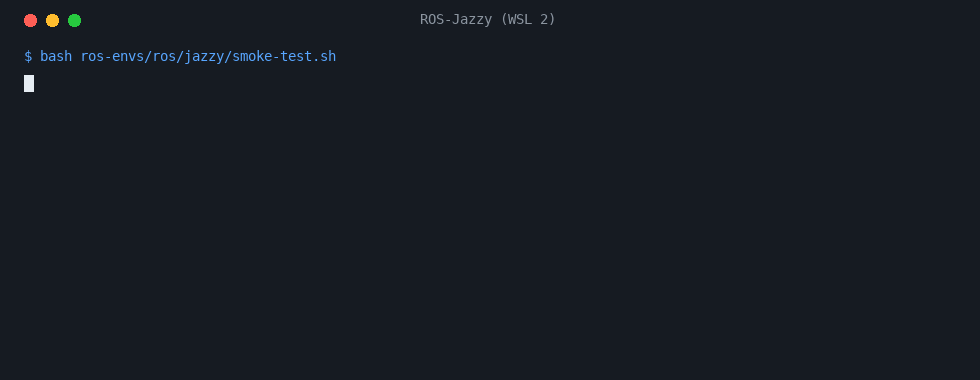

# ros-envs

[English](README.md) · **Español**

**ROS Noetic o ROS 2 Jazzy con Gazebo funcionando en WSL 2, Distrobox o Docker, instalado por un solo script y comprobado con una prueba de humo.**

[](https://github.com/Huxsby/ros-envs/actions/workflows/environments.yml) [](https://github.com/Huxsby/ros-envs/releases) [](LICENSE)



*La salida real de la prueba de humo de Jazzy en una distro `ROS-Jazzy` recién instalada, reproducida; se omite el informe del equipo.*

```bash
curl -fsSL https://raw.githubusercontent.com/Huxsby/ros-envs/v1.0.1/install.sh | bash -s -- distrobox jazzy
```

Eso es Linux con Distrobox. Windows, un Ubuntu existente y Docker están en [Instalación](#instalación).

Tres tipos de anfitrión:

| Entorno | Ubuntu | ROS | Simulador | Python | WSL | Distrobox | Docker |
|---|---|---|---|---|---|---|---|
| Noetic | 20.04 | ROS 1 Noetic (sin soporte desde mayo de 2025) | Gazebo 11 (Classic) | 3.8 | `ROS-Noetic` | `ros-noetic` | `docker/noetic` |
| Jazzy | 24.04 | ROS 2 Jazzy (LTS hasta mayo de 2029) | Gazebo Harmonic | 3.12 | `ROS-Jazzy` | `ros-jazzy` | `docker/jazzy` |

Noetic y Jazzy no pueden compartir una versión de Ubuntu: ROS 1 no tiene paquetes para 22.04 o posteriores. Por eso cada entorno vive aparte, con sus paquetes, su `.bashrc` y su workspace (`~/catkin_ws` o `~/ros2_ws`).

## Instalación

Cada opción tiene su propia guía, con todas las partes de los comandos explicadas.

En Windows, con PowerShell ([guía](wsl/README.es.md)):

```powershell
curl.exe -fLO https://raw.githubusercontent.com/Huxsby/ros-envs/v1.0.1/wsl/install.ps1
powershell -ExecutionPolicy Bypass -File .\install.ps1 -Distro jazzy -User <usuario de linux> -TimeZone <Area/City>
```

`<Area/City>` es un *TZ identifier* de la [lista de zonas horarias](https://en.wikipedia.org/wiki/List_of_tz_database_time_zones), como `Europe/Madrid`.

En Linux, con Distrobox ([guía](distrobox/README.es.md)):

```bash
curl -fsSL https://raw.githubusercontent.com/Huxsby/ros-envs/v1.0.1/install.sh | bash -s -- distrobox jazzy
```

En un Ubuntu 20.04 o 24.04 ya en marcha, como una máquina virtual:

```bash
curl -fsSL https://raw.githubusercontent.com/Huxsby/ros-envs/v1.0.1/install.sh | bash -s -- ubuntu jazzy
```

En un servidor, desde el navegador: ver la guía de Docker de [Noetic](docker/noetic/README.es.md) o de [Jazzy](docker/jazzy/README.es.md).

### `install.sh`

```text
install.sh ubuntu <noetic|jazzy>                       en un Ubuntu ya en marcha; pide sudo
install.sh distrobox <noetic|jazzy> [--link DIR]       en un anfitrión Linux: crea una caja
install.sh root <noetic|jazzy> <usuario> [zona]        solo el paso de root
install.sh user <noetic|jazzy>                         solo el paso de usuario
```

Elige el entorno que corresponde a tu Ubuntu: `noetic` necesita 20.04 y `jazzy` necesita 24.04, y el paso de root se detiene en cualquier otra versión. `root` y `user` son las dos mitades de `ubuntu`, y `wsl/install.ps1` las llama con un reinicio entre medias.

Los instaladores descargan una versión fija a una carpeta temporal y la borran al terminar. Para leer antes lo que se va a ejecutar, clona el repositorio y llama a `bash install.sh ...` desde él: un clon se usa tal cual, sin descargar nada.

## Qué se instala

- **ROS**: `desktop-full` con su simulador, SMACH, `teleop-twist-keyboard` y, en Jazzy, también YASMIN, `ros_gz` y `tf-transformations`.
- **Librerías**: numpy, pandas, matplotlib y ffmpeg.
- **Herramientas**: `gh`, `tmux`, `zip`, `shellcheck` y `pyflakes`.
- **Ajustes del equipo**: `ros/machine.sh` elige cómo renderizar y cuántos trabajos de compilación usar.

## Detección del equipo

`ros/machine.sh` se ejecuta al instalar y escribe `~/.config/ros-envs/machine.sh`, que carga `~/.bashrc`. Hay que repetirlo al pasar a otro equipo o al cambiar el controlador de la GPU o `.wslconfig`.

```bash
bash ros/machine.sh                  # informe, sin cambiar nada
bash ros/machine.sh --save           # vuelve a detectar y guarda
bash ros/machine.sh --save software  # fuerza el render por software (o NVIDIA, AMD, Intel)
bash ros/machine.sh --jobs           # escribe el número de trabajos de compilación
```

- **GPU.** Prueba NVIDIA, AMD e Intel, por ese orden, y se queda con la primera que renderiza de verdad con aceleración, porque `d3d12` en WSL no funciona en todos los equipos. Si ninguna sirve, usa render por software, más lento pero estable.
- **Trabajos de compilación.** Uno por núcleo, y como mucho uno por cada 2 GB de memoria: un `g++` de ROS ocupa 1-2 GB, y si se acaba la memoria la compilación muere sin decir por qué.
- **Por qué importa más en Jazzy.** El láser de la prueba de humo de Noetic lo calcula la CPU. En Gazebo Harmonic el láser habitual, `gpu_lidar`, se renderiza, así que sin GPU va más lenta la propia simulación, no solo su ventana.

## Pruebas de humo

Cada entorno tiene una prueba que no necesita ningún proyecto y usa sus propios puertos o dominio, así que puede correr junto a otra simulación. Debe terminar en `SMOKE TEST OK`.

```bash
bash ros/noetic/smoke-test.sh
bash ros/jazzy/smoke-test.sh
```

Importa las librerías de Python, ejecuta una máquina SMACH y arranca una simulación sin ventana con un robot diferencial frente a una pared. Después comprueba que el láser ve la pared a 2,9 m y que `cmd_vel` mueve el robot, y muestra el factor de tiempo real.

## Uso desde un proyecto

Un proyecto puede fijar una versión de estos entornos como submódulo de Git y llamar a `ros/machine.sh --jobs` o a una prueba de humo desde su Makefile:

```bash
git submodule add https://github.com/Huxsby/ros-envs.git tools/ros-envs
```

Conviene que los comandos básicos del proyecto no dependan del submódulo: `git clone` no descarga submódulos sin `--recurse-submodules`, ni siquiera con `submodule.recurse` activado.

## Comprobaciones

[`environments.yml`](.github/workflows/environments.yml) se ejecuta solo para los grupos que toca el cambio, nunca por documentación, y una vez por semana para todos, porque casi todo lo que se rompe viene de fuera: claves caducadas, imágenes retiradas o paquetes que cambian. Desde la pestaña Actions, *Run workflow* puede lanzar un solo grupo. [`secrets.yml`](.github/workflows/secrets.yml) ejecuta `gitleaks` en cada push, también de documentación, porque este repositorio es público.

| Grupo | Qué demuestra | Qué no demuestra |
|---|---|---|
| Nativo | `install.sh` y las pruebas de humo en contenedores Ubuntu limpios | |
| Distrobox | `install.sh distrobox`, sobre podman | El acceso a la GPU |
| Docker | Construcción de la imagen, comprobación de la contraseña, respuesta de code-server y noVNC, prueba de humo | |
| WSL | `install.ps1` en un runner de Windows | Las pruebas de humo, WSLg y el acceso a la GPU. Se permite que falle, porque los runners alojados no admiten WSL 2 de forma oficial |

## Publicar una versión

1. Actualiza la versión en `install.sh`, `wsl/install.ps1` y los comandos de instalación de los dos README.
2. Fusiona en `main` y espera a las comprobaciones.
3. `git tag vX.Y.Z && git push origin vX.Y.Z`.

## Contribuir

Las issues y los pull requests son bienvenidos, en inglés o en castellano: ver [CONTRIBUTING.es.md](CONTRIBUTING.es.md). Las preguntas van a [Discussions](https://github.com/Huxsby/ros-envs/discussions). Los cambios de cada versión están en [CHANGELOG.md](CHANGELOG.md).

## Licencia

[MIT](LICENSE)
