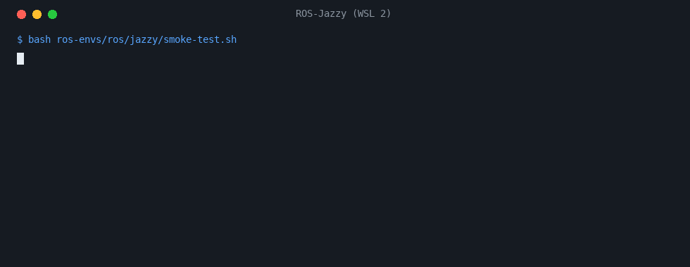

# ros-envs

**English** · [Español](README.es.md)

**A working ROS 1 (Kinetic, Melodic or Noetic) or ROS 2 Jazzy with Gazebo on WSL 2, Distrobox or Docker, installed by one script and checked by a smoke test.**

[](https://github.com/Huxsby/ros-envs/actions/workflows/environments.yml) [](https://github.com/Huxsby/ros-envs/releases) [](LICENSE)



*The real output of the Jazzy smoke test on a fresh `ROS-Jazzy` distro, replayed; the report of the machine is left out.*

```bash
curl -fsSL https://raw.githubusercontent.com/Huxsby/ros-envs/v1.0.1/install.sh | bash -s -- distrobox jazzy
```

That is Linux with Distrobox. Windows, an existing Ubuntu and Docker are under [Install](#install).

Three kinds of host:

| Environment | Ubuntu | ROS | Simulator | Python | WSL | Distrobox | Docker |
|---|---|---|---|---|---|---|---|
| Kinetic | 16.04 | ROS 1 Kinetic (EOL April 2021) | Gazebo 7 (Classic) | 2.7 | `ROS-Kinetic` | `ros-kinetic` | |
| Melodic | 18.04 | ROS 1 Melodic (EOL May 2023) | Gazebo 9 (Classic) | 2.7 | `ROS-Melodic` | `ros-melodic` | |
| Noetic | 20.04 | ROS 1 Noetic (EOL May 2025) | Gazebo 11 (Classic) | 3.8 | `ROS-Noetic` | `ros-noetic` | `docker/noetic` |
| Jazzy | 24.04 | ROS 2 Jazzy (LTS until May 2029) | Gazebo Harmonic | 3.12 | `ROS-Jazzy` | `ros-jazzy` | `docker/jazzy` |

No two environments share an Ubuntu release: each ROS release is built for one, and ROS 1 has no packages for 22.04 or later. Each environment therefore lives on its own, with its own packages, `.bashrc` and workspace (`~/catkin_ws` or `~/ros2_ws`). Kinetic and Melodic are for code that has to run where those releases still do, such as a course virtual machine: see [Kinetic and Melodic](#kinetic-and-melodic).

## Install

Each option below has its own guide, with every part of the commands explained.

Windows, in PowerShell ([guide](wsl/README.md)):

```powershell
curl.exe -fLO https://raw.githubusercontent.com/Huxsby/ros-envs/v1.0.1/wsl/install.ps1
powershell -ExecutionPolicy Bypass -File .\install.ps1 -Distro jazzy -User <linux user> -TimeZone <Area/City>
```

`<Area/City>` is a *TZ identifier* from the [list of time zones](https://en.wikipedia.org/wiki/List_of_tz_database_time_zones), such as `Europe/Madrid`.

Linux, with Distrobox ([guide](distrobox/README.md)):

```bash
curl -fsSL https://raw.githubusercontent.com/Huxsby/ros-envs/v1.0.1/install.sh | bash -s -- distrobox jazzy
```

An Ubuntu 16.04, 18.04, 20.04 or 24.04 that is already running, such as a virtual machine:

```bash
curl -fsSL https://raw.githubusercontent.com/Huxsby/ros-envs/v1.0.1/install.sh | bash -s -- ubuntu jazzy
```

A server, through the browser: see the Docker guide of [Noetic](docker/noetic/README.md) or [Jazzy](docker/jazzy/README.md).

### `install.sh`

```text
install.sh ubuntu <distro>                       on an Ubuntu already running; asks for sudo
install.sh distrobox <distro> [--link DIR]       on a Linux host: creates a box
install.sh root <distro> <user> [time zone]      only the root step
install.sh user <distro>                         only the user step
distro: kinetic, melodic, noetic or jazzy
```

Pick the environment that matches the Ubuntu: `kinetic` needs 16.04, `melodic` 18.04, `noetic` 20.04 and `jazzy` 24.04, and the root step stops on any other release. `root` and `user` are the two halves of `ubuntu`, and `wsl/install.ps1` calls them with a restart in between.

The installers download a fixed release to a temporary folder and delete it when they finish. To read what will run first, clone the repository and call `bash install.sh ...` from it: a clone is used as it is, with nothing downloaded.

## What gets installed

- **ROS**: `desktop-full` with its simulator, SMACH, `teleop-twist-keyboard`, and on Jazzy also YASMIN, `ros_gz` and `tf-transformations`.
- **Libraries**: numpy, pandas, matplotlib and ffmpeg, for the Python that ROS uses: 2.7 on Kinetic and Melodic.
- **Tools**: `gh`, `tmux`, `zip`, `shellcheck` and `pyflakes`.
- **Machine setup**: `ros/machine.sh` picks how to render and how many compile jobs to use.

## Machine detection

`ros/machine.sh` runs on install and writes `~/.config/ros-envs/machine.sh`, which `~/.bashrc` loads. Run it again after moving to another machine or changing the GPU driver or `.wslconfig`.

```bash
bash ros/machine.sh                  # report, changes nothing
bash ros/machine.sh --save           # detect again and save
bash ros/machine.sh --save software  # force software rendering (or NVIDIA, AMD, Intel)
bash ros/machine.sh --jobs           # print the number of compile jobs
```

- **GPU.** It tries NVIDIA, AMD and Intel in that order and keeps the first that really renders with acceleration, because `d3d12` on WSL does not work on every machine. Otherwise it falls back to software rendering, which is slower but stable. On WSL, Kinetic and Melodic always render by software: the `d3d12` driver arrived in Mesa 21, after Ubuntu 18.04.
- **Compile jobs.** One per core, with at most one per 2 GB of memory: a ROS `g++` takes 1-2 GB, and running out of memory kills the build without saying why.
- **Why it matters more on Jazzy.** The Noetic laser in the smoke test is computed by the CPU. On Gazebo Harmonic the usual laser, `gpu_lidar`, is rendered, so without a GPU the simulation itself runs slower, not only its window.

## Smoke tests

Each environment has a test that needs no project and uses its own ports or domain, so it can run next to another simulation. It must end in `SMOKE TEST OK`.

```bash
bash ros/kinetic/smoke-test.sh
bash ros/melodic/smoke-test.sh
bash ros/noetic/smoke-test.sh
bash ros/jazzy/smoke-test.sh
```

The three ROS 1 environments share their scripts, in `ros/ros1`; each `ros/<distro>` folder only calls them.

It imports the Python libraries, runs a SMACH machine, and starts a headless simulation with a differential robot facing a wall. It then checks that the laser sees the wall at 2.9 m and that `cmd_vel` moves the robot, and it prints the real time factor.

## Kinetic and Melodic

They reached end of life in 2021 and 2023, and so did their Ubuntu releases, which only get security updates with Ubuntu Pro. They are installed on WSL 2 and Distrobox, without a Docker image.

- **Python 2.7.** Their official packages, `rospy` and `cv2` included, were built for Python 2.7, the `python` of their Ubuntu. Python 3 is there too (3.5 on 16.04, 3.6 on 18.04), but without ROS. Code for these releases has to run on 2.7, or on both.
- **Frozen packages.** They come from `packages.ros.org`, which keeps them as they were when each release ended, signed with the current ROS key. They will not change: if that ever stops working, the final [snapshots](http://snapshots.ros.org/) hold the same packages.
- **The WSL images** are Canonical's official ones from 2019, still linked from Microsoft's documentation. `install.ps1` updates their certificates and `curl` before anything else.

## Using it from a project

A project can pin a version of these environments as a Git submodule and call `ros/machine.sh --jobs` or a smoke test from its Makefile:

```bash
git submodule add https://github.com/Huxsby/ros-envs.git tools/ros-envs
```

Avoid depending on the submodule for basic project commands: `git clone` does not fetch submodules unless it is given `--recurse-submodules`, not even with `submodule.recurse` set.

## Testing

[`environments.yml`](.github/workflows/environments.yml) runs only for the groups that a change touches, never for documentation, and for all of them once a week, because most breakage comes from outside: expired keys, removed images or changed packages. From the Actions tab, *Run workflow* can run a single group. [`secrets.yml`](.github/workflows/secrets.yml) runs `gitleaks` on every push, documentation included, because this repository is public.

| Group | What it proves | What it does not prove |
|---|---|---|
| Native | `install.sh` and the smoke tests on plain Ubuntu containers | |
| Distrobox | `install.sh distrobox`, on podman | GPU access |
| Docker | Image build, password check, code-server and noVNC answering, smoke test | |
| WSL | `install.ps1` and the smoke tests on a Windows runner | WSLg and GPU access. Allowed to fail, because hosted runners do not officially support WSL 2 |

## Releasing

1. Update the version in `install.sh`, `wsl/install.ps1` and the install commands of both READMEs.
2. Merge to `main` and wait for the checks.
3. `git tag vX.Y.Z && git push origin vX.Y.Z`.

## Contributing

Issues and pull requests are welcome, in English or Spanish: see [CONTRIBUTING.md](CONTRIBUTING.md). Questions go to [Discussions](https://github.com/Huxsby/ros-envs/discussions). Changes per version are in [CHANGELOG.md](CHANGELOG.md).

## License

[MIT](LICENSE)
